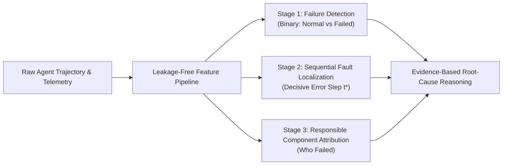

# METHODOLOGY: Heterogeneous Multi-View Trace Fusion for AI Agent Failure Diagnosis & Root-Cause Attribution

**Course:** Applications and Use Cases of Machine Learning (AUCML — TE7483)  
**Institution:** Symbiosis Institute of Technology (SIT), Pune — AIML Department  

---

## 1. Problem Formulation & System Overview

Autonomous LLM agents increasingly execute long-horizon, multi-step tasks across codebases, web applications, and external APIs. When these systems fail, standard binary test suite signals fail to explain the underlying failure modes.

We formulate the agent reliability challenge through a three-stage machine learning pipeline:

### 1.1 Task A: Execution Failure Detection
Given an execution trial represented by tabular telemetry $\mathbf{x} \in \mathbb{R}^{d}$ and a tool-call sequence $\mathbf{s} = (s_1, s_2, \dots, s_L)$, predict the probability of unrecoverable execution failure:
$$P(y = 1 \mid \mathbf{x}, \mathbf{s}) = \sigma(f_{\theta}(\mathbf{x}, \mathbf{s}))$$
where $y \in \{0, 1\}$ denotes whether all verification requirements succeeded ($y=0$) or failed ($y=1$).

### 1.2 Task B: Temporal Fault Localization
Given a multi-turn trajectory of $T$ sequential interaction steps, identify the decisive mistake step $t^* \in \{0, 1, \dots, T-1\}$ where the critical execution error was introduced:
$$t^* = \arg\max_{t \in [0, T-1]} P(e_t = 1 \mid \text{Turn}_t)$$

### 1.3 Task C: Component Attribution
Predict the responsible agent or subsystem $c^* \in \mathcal{C}$ (e.g., WebSurfer, Orchestrator, Assistant, FileSurfer):
$$c^* = \arg\max_{c \in \mathcal{C}} P(c \mid \text{Trajectory})$$

---

## 2. Leakage-Free Preprocessing & Feature Engineering

### 2.1 Grouped Splitting Strategy
To eliminate data leakage, data partitioning is performed strictly at the `task_id` level using `GroupShuffleSplit`:
- **Train Split (70%):** 8,298 trials across 4,055 unique tasks.
- **Validation Split (15%):** 1,701 trials across 869 unique tasks.
- **Test Split (15%):** 1,996 trials across 869 unique tasks.
- **Zero Inter-Set Overlap:** $\text{Tasks}_{\text{Train}} \cap \text{Tasks}_{\text{Val}} = \emptyset$, $\text{Tasks}_{\text{Train}} \cap \text{Tasks}_{\text{Test}} = \emptyset$.

### 2.2 Mathematical Formulations of Derived Telemetry Features
Every derived feature is calculated strictly within an individual trial record:
1. **Normalized Error Rate:**
   $$\text{DERIVED\_error\_rate} = \frac{\text{error\_count}}{\max(1, \text{tool\_calls\_total})}$$
2. **Diagnostic Retry Ratio:**
   $$\text{DERIVED\_retry\_ratio} = \frac{\text{retry\_count}}{\max(1, \text{error\_count})}$$
3. **Search-to-Edit Exploration Ratio:**
   $$\text{DERIVED\_search\_to\_edit\_ratio} = \frac{\text{search\_tool\_calls}}{\max(1, \text{edit\_tool\_calls})}$$
4. **Code Edit Churn:**
   $$\text{DERIVED\_edit\_churn} = \frac{\text{patch\_size\_lines}}{\max(1, \text{unique\_files\_edited})}$$
5. **Tool Call Entropy (Information-Theoretic Diversity):**
   $$H(\mathbf{s}) = -\sum_{i=1}^{V} p(s_i) \log p(s_i)$$
   where $p(s_i)$ is the empirical frequency of tool $s_i$ in the trial sequence.

---

## 3. Model Progression & Architecture

### 3.1 Model 1: Linear Benchmark (Logistic Regression)
Weighted cross-entropy with L2 regularization:
$$\mathcal{L}_{LR}(\mathbf{w}) = -\sum_{i=1}^{N} \left[ w_1 y_i \log(\hat{y}_i) + (1 - y_i) \log(1 - \hat{y}_i) \right] + \frac{\lambda}{2} \|\mathbf{w}\|_2^2$$
where class weight $w_1 = \frac{N - N_{pos}}{N_{pos}} \approx 3.34$.

### 3.2 Model 2: Tabular Ensembles (Random Forest & XGBoost)
- **Random Forest:** Ensemble of 150 balanced decision trees (max depth = 12).
- **XGBoost:** Gradient boosted trees with `scale_pos_weight = 3.34`, optimizing logloss with shrinkage rate $\eta = 0.08$.

### 3.3 Model 3: Trajectory Sequence Model (BiLSTM)
Tool tokens are mapped to dense embeddings $\mathbf{e}_t \in \mathbb{R}^{32}$ and processed by a Bidirectional LSTM:
$$\mathbf{h}_t = [\overrightarrow{\text{LSTM}}(\mathbf{e}_t) \,\|\, \overleftarrow{\text{LSTM}}(\mathbf{e}_t)] \in \mathbb{R}^{128}$$
$$\mathbf{h}_{seq} = \max_{t \in [1, L]} \mathbf{h}_t \quad (\text{Temporal Max-Pooling})$$

### 3.4 Model 4: Proposed Multi-View Gated Fusion Network
Combines structured execution telemetry $\mathbf{x} \in \mathbb{R}^{88}$ with sequential trajectory tokens $\mathbf{s} \in \mathbb{N}^{L}$:
1. **Telemetry Branch:** $\mathbf{h}_{tab} = \text{MLP}(\mathbf{x}) \in \mathbb{R}^{64}$
2. **Trajectory Branch:** $\mathbf{h}_{seq} = \text{BiLSTM-Pool}(\mathbf{s}) \in \mathbb{R}^{64}$
3. **Gated Attention Fusion Mechanism:**
   $$\mathbf{g} = \sigma(\mathbf{W}_g [\mathbf{h}_{tab} \,\|\, \mathbf{h}_{seq}] + \mathbf{b}_g) \in (0, 1)^{64}$$
   $$\mathbf{h}_{fused} = \mathbf{g} \odot \mathbf{h}_{tab} + (\mathbf{1} - \mathbf{g}) \odot \mathbf{h}_{seq}$$
4. **Classification Head:** $\hat{y} = \sigma(\mathbf{W}_c \mathbf{h}_{fused} + b_c)$

---

## 4. Evidence-Based Root-Cause Reasoning
Rather than making unfounded causal claims, model explainability is grounded through **SHAP (SHapley Additive exPlanations)**:
$$\phi_i(f, \mathbf{x}) = \sum_{S \subseteq F \setminus \{i\}} \frac{|S|!(|F| - |S| - 1)!}{|F|!} [f(S \cup \{i\}) - f(S)]$$
Top predictive signals (e.g., `DERIVED_edit_churn`, `DERIVED_retry_ratio`, `DERIVED_tool_intensity`) provide the empirical evidence justifying the failure diagnosis.
