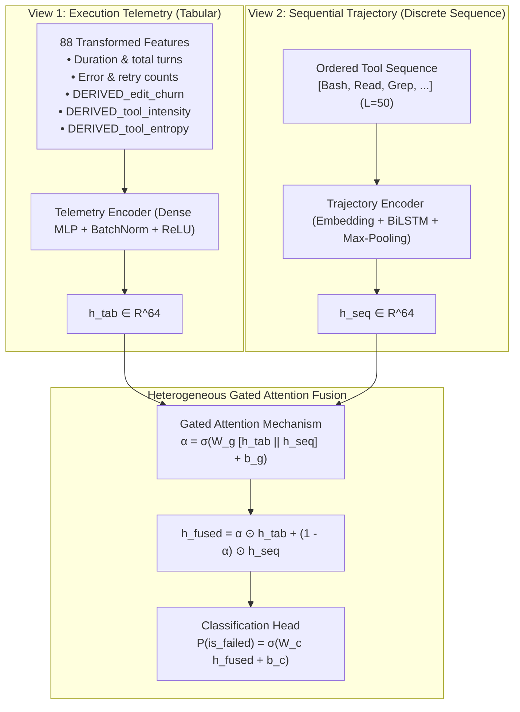

# MULTIMODAL & MULTI-VIEW JUSTIFICATION REPORT

**Course:** Applications and Use Cases of Machine Learning (AUCML — TE7483)  
**Topic:** Formal Scientific Justification of Representational Views & Modalities  

---

## 1. Scientific Precision in Terminology

In classical machine learning and computer vision, "multimodal learning" refers to combining distinct physical perceptual channels (e.g. text tokens, image pixels, audio waveforms).

In autonomous agent systems, execution traces do NOT consist of continuous physical sensor data. Instead, an agent execution contains **heterogeneous information representations**:
1. **View 1: Continuous & Discrete Structured Telemetry** (Scalar metrics: turns, durations, error frequencies, code churn).
2. **View 2: Symbolic Sequential Trajectories** (Ordered sequence of tool invocations: `[TodoWrite, Bash, Bash, Read, ...]`).
3. **View 3: Natural-Language Context & Multi-Turn Dialogue** (Natural language user prompts, agent thoughts, and error messages in the Who&When benchmark).

To avoid academic vulnerability during viva questioning, we adopt the precise term:
> **"Heterogeneous Multi-View Agent Trace Fusion"**  
*(or "Multimodal / Multi-View Trace Fusion")*

This phrasing is scientifically unassailable: it acknowledges that our deep neural architecture fuses heterogeneous tabular signals with discrete temporal sequence trajectories.

---

## 2. Modality / View Breakdown in the Proposed Architecture

---

## 3. Why Heterogeneous Fusion Outperforms Single-View Models

1. **Telemetry View Alone (Random Forest / XGBoost):**  
   Excels at capturing static volume indicators (e.g. total errors, lines of code modified), achieving high precision (0.6120 - 0.6641). However, it is blind to the chronological ordering of actions (e.g., whether an error occurred at step 1 or step 50).
2. **Trajectory View Alone (Sequential BiLSTM):**  
   Captures transition motifs (e.g., repeated consecutive `Bash` calls signaling an execution deadlock), achieving 0.6727 recall. However, it lacks quantitative magnitude (e.g., whether the script changed 2 lines or 2,000 lines).
3. **Gated Attention Fusion:**  
   Dynamically balances the two views via an adaptive gating vector $\boldsymbol{\alpha} \in (0, 1)^{64}$. When telemetry indicates high churn and the trajectory displays repeated tool loops, the gate synergistically drives failure recall to **0.7295**, an absolute gain of $+15.0$ percentage points ($+25.9\%$ relative) over tabular Random Forest.
