# PROJECT AUDIT: AUCML ESE Project Baseline Review

**Date of Audit:** October 24, 2026  
**Auditor:** Lead ML Engineer  
**Course:** Applications and Use Cases of Machine Learning (AUCML — TE7483)  
**Institution:** Symbiosis Institute of Technology (SIT), Pune — AIML Department  

---

## Executive Summary
This audit rigorously evaluates the initial project state against the AUCML ESE evaluation rubric (30 marks) and the strict mandate for **real, verifiable, non-fabricated, and scientifically sound data**. 

All model training has been halted. The initial direction relied on preliminary candidates (`ToolFailBench` and a 19-record slice of `MAD`) that contain synthetic mock tool returns or sample sizes insufficient for standalone ML research. This document identifies all strengths, weaknesses, invalid assumptions, and prescribes a reformed, research-grade architecture.

---

## A. What Is Currently Correct
1. **Rubric Alignment Awareness:** The repository contains the official evaluation rubric (`Detailed ESE Evaluation Rubric .pdf`), faculty guidelines from Dr. Sumanto Dutta (`Instructions.png`, `Screenshot 2026-10-23 234749.png`), and group registration verification.
2. **Hardware Profiling:** Hardware capabilities have been accurately audited:
   - GPU: NVIDIA GeForce RTX 5060 Laptop GPU (8 GB GDDR6 VRAM, CUDA 12.9)
   - Host Memory: 16 GB RAM
   - Environment: Python 3.11.9 with core scientific stack (`numpy`, `pandas`, `scikit-learn`, `xgboost`, `shap`, `imbalanced-learn`).
3. **Zero Fabricated Results:** No models have been trained prematurely, no synthetic metrics have been fabricated, and no fake confusion matrices or accuracy numbers exist in the project.
4. **Structured Project Skeleton:** The modular folder layout (`data/`, `src/`, `results/`, `app/`, `configs/`) conforms to standard ML software engineering practices.

---

## B. What Is Currently Incorrect or Problematic
1. **Over-reliance on Mock/Synthetic Tool Telemetry (`ToolFailBench`):**
   - While `ToolFailBench` contains 2,000 evaluations across Claude and GPT-5.4-mini, the tool interactions are generated against synthetic mock API environments (`mock_tool_return`) with predefined conflict traps.
   - It represents controlled benchmark testing rather than natural, in-the-wild developer or user agentic executions.
2. **Insufficient Sample Size in Human-Labelled `MAD`:**
   - The human-labelled subset of `MAD` has only 19 traces. The remaining records in `mcemri/MAD` rely on LLM-as-a-judge pseudo-labels, which introduces circular LLM evaluation bias if used as ground truth for an ML model.
3. **Premature Task Assumption:**
   - The task taxonomy (5-class tool failure) was assumed before surveying larger authentic datasets (such as TraceLab, Agent Diagnostics, and CMU Agent Trajectories).
4. **Unsubstantiated Multimodal Claims:**
   - The project title ("Multimodal AI...") must be justified by genuine, multi-channel data representations (e.g., sequential tool-call trajectories, structured numerical/categorical telemetry, and unstructured semantic text). If the final selected dataset does not exhibit distinct modalities, the title must be adapted.

---

## C. What Must Be Removed or Deprioritized
1. **Remove `ToolFailBench` as the Primary Training Data:**
   - Do not claim mock benchmark runs as real production telemetry. Move it to an exploratory/comparison candidate.
2. **Remove Unverified Failure Taxonomies:**
   - Discard arbitrary failure classes that cannot be traced to an immutable ground-truth label in the raw dataset.
3. **Remove Any Draft Scripts Dependent on Synthetic Mock Fields:**
   - Deprecate preliminary profilers that assume `mock_tool_return` schemas.

---

## D. What Can Be Retained
1. **Modular Directory Structure:** Retain the clean separation between `src/data/`, `src/preprocessing/`, `src/models/`, `src/training/`, `src/evaluation/`, and `app/`.
2. **`Who&When` Benchmark:** Retain `Who&When` (ICML 2025 Spotlight, 184 full multi-agent trajectories, 4,092 execution turns) as a specialized, peer-reviewed evaluation benchmark for **Task C (Temporal Fault Localization)** and **Task D (Component Attribution)**.
3. **Rubric Traceability Matrix:** Retain the mapping methodology in `RUBRIC_MAPPING.md`, updating evidence paths once the new data is integrated.

---

## E. What Should Be Improved
1. **Integrate Genuine In-The-Wild Datasets:**
   - Systematically audit and download large-scale real-user agent traces:
     - **TraceLab (UW-SyFI):** ~8,058 real developer coding sessions, 665,453 agent steps, 743,819 tool calls.
     - **Agent Diagnostics:** Curated failure traces across multi-agent benchmarks with verified diagnostic annotations.
     - **CMU Agent Trajectories (`cx-cmu/agent_trajectories`):** 8,653 trajectories with conversation traces, tool calls, and objective reward/evaluation metrics.
     - **Trace Commons (`trace-commons/agent-traces`):** Real-world agent sessions.
     - **FreeInference Agentic Dataset:** Large-scale telemetry sessions for observational validation.
2. **Data Provenance & Governance:**
   - Implement `SOURCE_MANIFEST.json` with cryptographic SHA-256 hashes, release tags, and exact URLs.
   - Generate `DATASET_CARD.md`, `DATA_DICTIONARY.csv`, `DATASET_SCHEMA.json`, and `FEATURE_DICTIONARY.csv`.
3. **Strict Data Leakage Prevention:**
   - Implement GroupKFold / GroupShuffleSplit strictly on `session_id` or `task_id`.
   - Ensure all transformations, scalers, tokenizers, and vectorizers are fitted only on training folds.
4. **Instrumentation of Live Agent Traces:**
   - Build a lightweight live agent execution harness in `src/live_tracing/` that runs real tasks (via local/open LLMs or accessible APIs), records genuine execution telemetry, and feeds the trace directly to our ML diagnostic pipeline.

---

## F. Final Recommended Project Architecture

```mermaid
flowchart TD
    subgraph Data_Sourcing["1. Authentic Data Foundation"]
        D1["Primary Training: TraceLab / Agent Diagnostics<br>(Real developer/agent executions)"]
        D2["Secondary Out-of-Domain: CMU Agent Trajectories<br>(Generalization test set)"]
        D3["Specialized Attribution: Who&When<br>(Step & component localization)"]
        D4["Live Instrumentation: Controlled Agent Harness<br>(Real-time execution capture)"]
    end

    subgraph Data_Governance["2. Data Governance & Provenance"]
        G1["source_manifest.json (Hashes & URLs)"]
        G2["DATASET_CARD.md & DATA_DICTIONARY.csv"]
        G3["Grouped Splitting (Zero Leakage)"]
    end

    subgraph Feature_Engineering["3. Multimodal Representation"]
        M1["Modality 1: Execution Telemetry (Durations, Errors, Steps, Tool Frequencies)"]
        M2["Modality 2: Sequential Trajectory (Step Order, Tool-Transition Matrix)"]
        M3["Modality 3: Text Semantics (Prompts, System Error Logs, Agent Thoughts)"]
    end

    subgraph Models["4. Progressive Model Hierarchy"]
        B1["Model 1: Logistic Regression / Random Forest Baseline"]
        B2["Model 2: Tabular Gradient Boosting (XGBoost)"]
        B3["Model 3: Sequential Deep Learning (BiLSTM / Lightweight Transformer)"]
        B4["Model 4: Proposed Cross-Modal Attention Fusion Network"]
    end

    subgraph Evaluation["5. Rigorous Evaluation & Explainability"]
        E1["In-Domain & Out-of-Domain Metrics (Macro-F1, PR-AUC, Confusion Matrix)"]
        E2["Modality Ablation Study (Telemetry vs Sequence vs Text)"]
        E3["Evidence-Based Root-Cause Attribution (SHAP + Attention Weights)"]
        E4["Interactive Demonstration Interface (Streamlit App)"]
    end

    Data_Sourcing --> Data_Governance
    Data_Governance --> Feature_Engineering
    Feature_Engineering --> Models
    Models --> Evaluation
```

